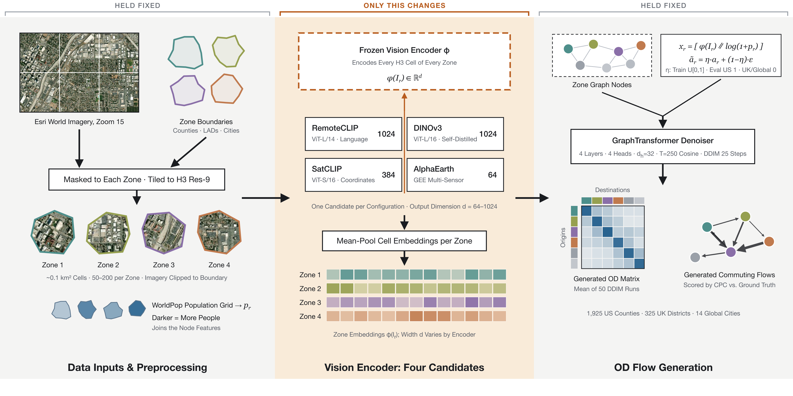
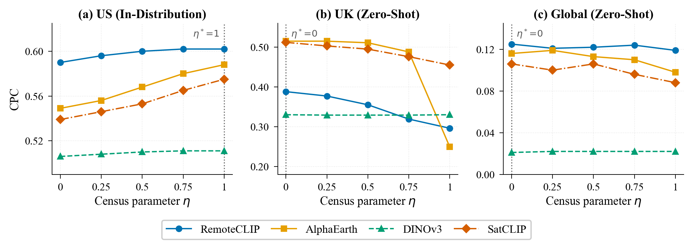
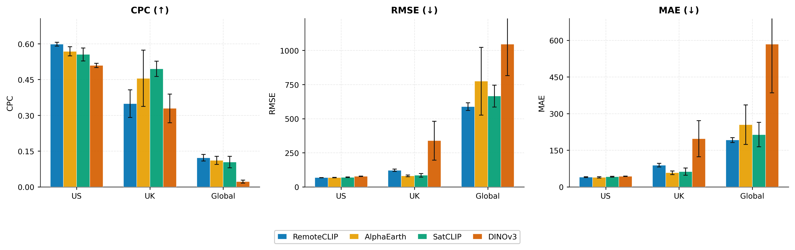

# Do Satellites See Commuters? A Critical Benchmark of Vision Foundation Models for Generative Urban Flow Networks (SIGSPATIAL 2026)

Official code, experiment configs and evaluation logs for the paper:

**Do Satellites See Commuters? A Critical Benchmark of Vision Foundation Models for Generative Urban Flow Networks**
Ashiq Shukoor Iqbal, Wilson Wongso, Flora Salim. The University of New South Wales.
ACM SIGSPATIAL 2026, Riverside, CA, USA. [arXiv:2609.00661](https://arxiv.org/abs/2609.00661) | [doi:10.1145/3841645.3842989](https://doi.org/10.1145/3841645.3842989)

## Abstract

Satellite foundation models offer a globally available alternative to census data for commuting origin-destination (OD) generation, yet no study has systematically compared encoder paradigms within a single downstream pipeline. We ablate four satellite vision encoders: language-supervised (RemoteCLIP), self-supervised (DINOv3), and geographically grounded (SatCLIP, AlphaEarth) within an identical WeDAN graph diffusion framework across 1,925 US counties, 325 UK districts, and 14 global cities under five random seeds. Three main findings emerge. First, language-supervised features achieve the strongest in-distribution performance (RemoteCLIP CPC 0.602), while geographically grounded encoders transfer more reliably zero-shot: AlphaEarth improves CPC by 33% over RemoteCLIP on UK districts. Second, pretraining corpus scale alone is insufficient: DINOv3, trained on a substantially larger satellite corpus, underperforms RemoteCLIP by 0.091 CPC in-distribution and collapses to CPC 0.022 globally. Third, no encoder transfers usefully to global cities (best CPC 0.122 for RemoteCLIP, 0.022 for DINOv3), confirming cross-continental OD generation remains an open problem. We additionally clarify the semantics of the census noise parameter η, whose ordering reverses under cross-continental evaluation, a distinction critical to correctly interpreting prior results. Training scripts and evaluation logs will be released.

<p align="center">
  
</p>

**Figure 1.** GlODGen pipeline. Satellite imagery and population data are preprocessed via H3 hexagonal tiling (resolution 9, about 0.1 km² per cell) with per-tile mean pooling. A spatial vision encoder extracts zone-level embeddings conditioning the WeDAN GraphTransformer diffusion model, which generates the OD flow matrix via DDIM sampling.

## Results

Common Part of Commuters (CPC, higher is better) at the primary evaluation point of each benchmark, mean over seeds (Tables 6 to 8 of the paper). US is reported at census parameter η = 1, UK and Global at η = 0. Table 3 of the paper reports means over all η levels.

<div align="center">

| Encoder    | Pretraining          | Dim  | US (η = 1) | UK (η = 0) | Global (η = 0) |
|:---:|:---:|:---:|:---:|:---:|:---:|
| RemoteCLIP | image and text       | 1024 | **0.602**  | 0.388      | **0.125**      |
| DINOv3     | self-distillation    | 1024 | 0.511      | 0.330      | 0.021          |
| SatCLIP    | image and location   | 384  | 0.575      | 0.512      | 0.114          |
| AlphaEarth | multi-sensor (GEE)   | 64   | 0.588      | **0.515**  | 0.116          |

</div>

<p align="center">
  
</p>

**Figure 2.** CPC as a function of census noise parameter η across all four encoders and three evaluation benchmarks (mean over 5 seeds). The dashed vertical line marks the primary evaluation point for each dataset (η = 1 for US; η = 0 for UK and Global). US performance increases monotonically with census availability, whereas UK and Global performance degrades as η → 1 due to the introduction of out-of-distribution zero-valued census vectors.

## Repository layout

```
RemoteCLIP/
  encoder/             GlODGen pipeline, including RemoteCLIP feature extraction
  code/                training and evaluation
  exp/config/          run configs
  exp/log/             evaluation logs
DINOv3/
  extract_imgfeat.py   DINOv3 feature extraction
  utils.py             tile helpers used by extract_imgfeat.py
  code/  exp/config/  exp/log/
SatCLIP/
  extract_imgfeat.py   SatCLIP feature extraction
  utils.py
  code/  exp/config/  exp/log/
AlphaEarth/
  build_imgfeat.py     builds features from Google's precomputed embeddings
  code/  exp/config/  exp/log/
```

The four `code/` folders contain the same WeDAN training and evaluation code, with small per-encoder differences (for example, which feature file is loaded, and how evaluation resumes). They are kept separate exactly as they were run.

## Requirements

Python 3.10 with a CUDA 12.4 GPU. The versions used for the paper:

```
torch==2.4.0+cu124
torchvision==0.19.0+cu124
dgl==2.4.0+cu124
torchdata==0.7.1
pydantic==2.13.3
numpy==2.2.6
pandas==2.3.3
scipy==1.15.3
scikit-learn==1.7.2
geopandas==1.1.3
shapely==2.1.2
rasterio==1.4.4
h3==4.4.2
contextily==1.7.0
matplotlib==3.10.9
pillow==12.2.0
requests==2.33.1
tqdm==4.67.3
setproctitle==1.3.7
timm==1.0.26
transformers==4.44.2
huggingface_hub==0.36.2
```

DGL must be installed from its CUDA 12.4 wheel index. Feature extraction also needs `open_clip_torch` (RemoteCLIP) and `earthengine-api` (AlphaEarth).

## Data

The datasets are not included in this repository.

- **US:** OD matrices and census features (97 American Community Survey attributes, `nfeat.npy`) from the [CommutingODGen dataset](https://github.com/tsinghua-fib-lab/CommutingODGen-Dataset), built from LODES 2018 commuting flows (US Census Bureau), for the 1,925 counties kept by GlODGen's filtering.
- **UK and Global:** the benchmarks released with GlODGen ([Rong et al., 2025](https://arxiv.org/abs/2505.15870)).
- **Population:** WorldPop.
- **Satellite imagery:** Esri World Imagery at zoom level 15. Downloading tiles requires an Esri token, read from the `ESRI_TOKEN` environment variable.

The code expects the GlODGen data layout, relative to each encoder folder:

```
data/US/<GEOID>/nfeat/nfeat.npy         census features (97 ACS attributes)
data/US/<GEOID>/nfeat/<name>.npy        image features from the extraction step
data/US/<GEOID>/adj/dis.npy             distance matrix
data/US/<GEOID>/od/od.npy               OD matrix
data/worldpop.npy
data/TEST_UK/<city>/...                 UK benchmark (same files plus worldpop.npy)
data/TEST/<city>/...                    Global benchmark
```

## Usage

### 1. Extract image features

RemoteCLIP needs no extraction step: its features (`imgfeat.npy`) are the precomputed ones distributed with the GlODGen dataset. `RemoteCLIP/encoder/` contains the GlODGen pipeline that produces them (`extract_imgfeats_RemoteCLIP` in `generate_od/sateimgs.py`).

For the other three encoders, run this step on a machine with internet access. It downloads satellite tiles and model weights. Each script writes one feature file per region into `nfeat/`.

```bash
export ESRI_TOKEN=<your token>

cd DINOv3
python extract_imgfeat.py --shp_dir /path/to/shapefiles --out_dir data/US \
    --ref_dir ../RemoteCLIP/data/US --token $ESRI_TOKEN

cd ../SatCLIP
python extract_imgfeat.py --shp_dir /path/to/shapefiles --out_dir data/US \
    --ref_dir ../RemoteCLIP/data/US --token $ESRI_TOKEN

cd ../AlphaEarth
python build_imgfeat.py --shp_dir /path/to/shapefiles --out_dir data/US \
    --ref_dir ../RemoteCLIP/data/US --ee_project <your-gee-project>
```

Repeat each command for the UK and Global benchmarks with `--out_dir data/TEST_UK` and `--out_dir data/TEST`, using their shapefiles and `--ref_dir ../RemoteCLIP/data/TEST_UK` or `../RemoteCLIP/data/TEST`. `--ref_dir` lists which regions to process.

- **DINOv3** loads `facebook/dinov3-vitl16-pretrain-sat493m` from Hugging Face by default.
- **SatCLIP** loads `microsoft/SatCLIP-ViT16-L40`. Its 13-band patch embedding is averaged into a single channel and repeated over RGB, as described in Section 4.2 of the paper.
- **AlphaEarth** reads Google's precomputed Satellite Embedding V1 from Earth Engine instead of running a model locally.

### 2. Train and evaluate

From the encoder's folder:

```bash
cd RemoteCLIP
python code/main.py --config exp/config/US_RemoteCLIP_2024.json        # train on the US
python code/main.py --config exp/config/EVAL_UK_RemoteCLIP_2024.json   # zero-shot UK
```

Every run also loads a pretrained denoiser from `exp/model/pretrain/pretrain.pkl` (GlODGen's DenoisingTransformer). All configs set `if-ImgAttrAug` to 0, which zeroes this model's output, so its weights do not affect any result; the checkpoint only needs to match the encoder's input size. Trained models are saved to `exp/model/<exp_name>/`.

## Configurations

Every run in the paper is defined by one JSON config. There are 59 runs: 4 encoders × 3 benchmarks × 5 seeds, except SatCLIP Global, which uses 4 seeds as in the paper. All 59 configs are included, one per run, in `<Encoder>/exp/config/`. Each config pairs by name with its evaluation log in `<Encoder>/exp/log/`.

<div align="center">

| Encoder    | US (train)                | UK (zero-shot)                 | Global (zero-shot)                 |
|:---:|:---:|:---:|:---:|
| RemoteCLIP | `US_RemoteCLIP_<seed>`    | `EVAL_UK_RemoteCLIP_<seed>`    | `GLOBAL_RemoteCLIP_<seed>`         |
| DINOv3     | `US_DINOv3_<seed>`        | `EVAL_UK_DINOv3_<seed>`        | `EVAL_GLOBAL_DINOv3_<seed>`        |
| SatCLIP    | `US_SatCLIP_<seed>`       | `EVAL_UK_SatCLIP_<seed>`       | `EVAL_GLOBAL_SatCLIP_<seed>`       |
| AlphaEarth | `US_AlphaEarth_<seed>`    | `EVAL_UK_AlphaEarth_<seed>`    | `EVAL_GLOBAL_AlphaEarth_<seed>`    |

</div>

`<seed>` is one of 2024, 2025, 2026, 2027, 2028. RemoteCLIP's Global configs keep an older `GLOBAL_` prefix; they are the same kind of run as the other encoders' `EVAL_GLOBAL_` configs.

The US configs train a model. The UK and Global configs do not train: each loads the checkpoint of the matching US run (named in `model_exp_name`) and evaluates it zero-shot on the target benchmark. Evaluation sweeps the census parameter η over {0, 0.25, 0.5, 0.75, 1} internally, so each log reports all five η levels.

### What changes between runs

<div align="center">

| Field               | US train  | UK eval               | Global eval           |
|:---:|:---:|:---:|:---:|
| `mode`              | `TRAIN`   | `EVAL`                | `EVAL`                |
| `test_specific`     | `0`       | `1`                   | `1`                   |
| `test_specific_dir` | not set   | `TEST_UK`             | `TEST`                |
| `model_exp_name`    | not set   | `US_<Encoder>_<seed>` | `US_<Encoder>_<seed>` |

</div>

In addition, every run sets its own `random_seed` and `exp_name`.

The train/validation/test split is 80/10/10 in every config (`train_set` 0.8, `valid_set` 0.1, `test_set` 0.1), and every config sets `EPOCH` to 300.

**Paths.** `data_path`, `img_data_path` and `worldpop_path` point to where the data lived on the machine that ran the experiments, so repoint them before running. RemoteCLIP's configs use the relative `data/US/`. The other three encoders read the shared data (OD matrices, census features, distances, WorldPop) from RemoteCLIP's data directory, and their own image features from `img_data_path`. The one exception is DINOv3 on the UK and Global benchmarks: like RemoteCLIP, it reads each city's files (OD, distances, WorldPop and image features) from its own `data/TEST_UK/` and `data/TEST/`, so copy the shared files there next to its image features.

### What never changes

All other settings are identical across the 59 runs. This is the controlled ablation described in Section 4.3: only the encoder changes. It includes every hyperparameter in Table 2 of the paper:

<div align="center">

| Paper (Table 2)              | Config key       | Value    |
|:---:|:---:|:---:|
| GraphTransformer layers      | `num_layer`      | 4        |
| Attention heads              | `num_head`       | 4        |
| Hidden dimension             | `hiddim`         | 32       |
| Diffusion training steps (T) | `T`              | 250      |
| Noise schedule               | `beta_scheduler` | cosine   |
| Learning rate                | `learning_rate`  | 0.001    |
| Optimizer                    | `optm`           | AdamW    |
| Batch size                   | `batch_size`     | 1        |
| Dropout                      | `dropout`        | 0        |
| DDIM sampling steps          | `DDIM_T_sample`  | 25       |
| Monte Carlo samples per city | `sample_times`   | 50       |

</div>

Other fixed pipeline settings: `loss` mse, `sample_method` DDIM, `DDIM_eta` 0, `skew_norm` log, `attr_MinMax` 1, `od_MinMax` 1, `split_TVT_geo` 0, `shuffle_cities` 0, `max_nodes` 3000, `norm_type` layer, `valid_period` 10, `overfit_tolerance` 100, `p_generation` 1, `p_featMissing` 0, `p_noisyAttr` -1, `if_imgAugDenosing` 1, `if-ImgAttrAug` 0 (zeros the predicted census vector, see Section 3.2), `num_head_cross` 1, `LaPE_dim` 0, `pert_node` 1, `if-logscaleEval` 0.

Run housekeeping, also fixed: `device`, `check_device`, `mem_need`, `exp_path`, `city_type_limit`.

## Evaluation logs

Each log in `<Encoder>/exp/log/` is named `<exp_name>_<seed>.json`. Metrics are stored per census noise level η under `eval_metrics` (US) or `eval_metrics_specific` (UK and Global), keyed by the η value as a string (`"0"`, `"0.25"`, `"0.5"`, `"0.75"`, `"1"`; five logs write `"0.0"` or `"1.0"`, so parse keys with `float()`). Each entry holds CPC, RMSE, NRMSE, MAE and several additional metrics. Training logs also record the full config and the training curve.

Tables 6 to 8 of the paper are the mean over seeds for each η. Table 3 is the mean over all seeds and η levels.

<p align="center">
  
</p>

**Figure 3.** Mean CPC, RMSE, and MAE per region across all η levels (mean ± std, 5 seeds), consistent with Table 3 of the paper. RemoteCLIP leads in-distribution (US); SatCLIP and AlphaEarth dominate zero-shot UK transfer; all encoders converge on Global cities. DINOv3 collapses to near-zero performance globally (CPC = 0.022).

## Citation

```bibtex
@inproceedings{iqbal2026satellites,
  author    = {Iqbal, Ashiq Shukoor and Wongso, Wilson and Salim, Flora},
  title     = {Do Satellites See Commuters? A Critical Benchmark of Vision Foundation Models for Generative Urban Flow Networks},
  booktitle = {Proceedings of the 34th ACM International Conference on Advances in Geographic Information Systems},
  series    = {SIGSPATIAL '26},
  year      = {2026},
  address   = {Riverside, CA, USA},
  publisher = {ACM},
  doi       = {10.1145/3841645.3842989}
}
```

## Acknowledgments

This work was supported by the ARC Centre of Excellence for Automated Decision-Making and Society (CE200100005), and used the Katana computational cluster supported by Research Technology Services at UNSW Sydney. The WeDAN architecture and the GlODGen codebase are by the Tsinghua University FIB Lab. We also build on RemoteCLIP, DINOv3, SatCLIP and AlphaEarth.

## License

The code in `RemoteCLIP/encoder/` comes from GlODGen and keeps its original license (`RemoteCLIP/encoder/LICENSE`). See `LICENSE` for the rest of this repository.
